# Daymark — the morning edition for perishable retail

**A daily decision brief for grocery fresh sections: what to order, what to mark down,
what to promote — every figure traceable to a demand model, every claim proven by a
deterministic replay, every decision signed into a tamper-evident ledger.**

Built for the **AMD Developer Hackathon: ACT III** · Track: **Reinvent Commerce** ·
Language layer served by **Gemma on AMD Instinct (vLLM · ROCm · AMD Developer Cloud)**.



---

## The problem

Fresh food is where a grocery store's money quietly dies. Every store, every morning,
someone decides how much to order, what to mark down before it spoils, and which
promotion to run — from memory, spreadsheets, and a supplier rep's opinion. Two leaks
follow: **shrink** (thrown-away fresh stock, 3–6% of fresh sales industry-wide) and
**lost sales** (empty shelves on the day demand peaks).

Enterprise "AI category management" exists (Afresh, Shelf Engine, Revionics) — but it is
expensive, opaque, closed, and not self-hostable. A mid-size chain's category manager
gets none of it. Meanwhile the data needed to do better already exists in the store.

## What Daymark is

- **A morning brief, printed by 6am.** Orders due tomorrow, markdowns before expiry,
  promo candidates with measured lift, and a watchlist of uncertain items — with reasons.
- **A verification-first AI product.** The forecaster computes every number; the model
  (Gemma, served on AMD) writes the language; a **number-grounding checker** rejects any
  copy containing a figure that is not in the facts. *The model decides, the LLM explains,
  the ledger proves.*
- **A self-proving product.** **Replay** re-runs the last ten weeks of real demand under
  three policies — the spreadsheet way, forecast-only, and the full Daymark policy — and
  prints the exact waste / lost-sales / service-level deltas. Identical demand, identical
  opening shelves, pure arithmetic.
- **A tamper-evident workflow.** Approve / edit / flag decisions are appended to a
  SHA-256 hash chain, re-verified on every read.

## Who it is for

The **category manager** of a small-to-mid grocery chain (5–60 stores): not a data
scientist, deciding before 7am, on a back-office PC or a phone. Secondary user: the
**store director**, who needs to see that AI decisions are auditable and affordable —
each brief displays its own inference cost (fractions of a cent on measured AMD
throughput).

## The replay proof (real data, exact arithmetic)



Store 2 (Quito), 70 days of Corporación Favorita demand, identical starting inventory
and shelf life for all three policies, deterministic simulator (Rust):

| Policy | Waste units | Lost units | Service level | Revenue |
|---|---|---|---|---|
| Spreadsheet (last weekday × 1.05) | 5,684 | 26,509 | 87.8% | $190,102 |
| Forecast-only (newsvendor) | 3,131 | 4,494 | 97.9% | $212,117 |
| **Daymark (forecasts + markdowns)** | **2,342** | 7,013 | 96.8% | **$215,251** |

- **−59% waste** and **+9.1 service points** vs the spreadsheet rule; **+25,149 units sold**.
- The markdown engine alone (vs forecast-only): **−789 waste units**, at a visible
  trade-off of 1.1 service points and 2.5k more lost sales — shown, not hidden.
- Reproduce: `make replay` (or `curl localhost:8787/api/replay?store=2`).

## Forecast quality (out-of-sample, held-out weeks)

| Metric | Value |
|---|---|
| WAPE (p50) on 54,872 held-out item-days | **26.7%** |
| Skill vs same-weekday baseline | **+27.1%** |
| p10–p90 band coverage | **78.8%** (target 80%) |
| Bias | −1.5% |

The Trust page in the app shows the same table per category, plus the measured promo
lift the markdown engine borrows from (median +28.3% across stores/items, capped at 40%
for planning) and the AMD serving benchmark.

## Architecture

- **`engine/` (Python, offline)** — downloads the public Favorita benchmark from
  HuggingFace, curates 3 stores × 242 fresh SKUs (2013–2017), trains **LightGBM quantile
  models** (p10/p50/p90) with strict leakage-free features, backtests them, measures real
  promo lift, exports parquet artifacts. Python is used only as offline data-science
  tooling; everything it produces is committed and inspectable.
- **`backend/` (Rust, Axum)** — the product core: newsvendor **order policy**, **markdown
  engine**, **deterministic perishable-store simulator + replay**, **grounding checker**,
  **hash-chained ledger** (SQLite), brief assembly, vLLM client, cost meter, REST API.
- **`web/` (Next.js + TypeScript)** — the "morning edition": editorial front page, one-click
  decisions, replay tapes with sensitivity dials, ledger, trust receipts. Custom design
  system (newsprint, serif headlines, mono figures) — deliberately not a dashboard.
- **AMD workload** — Gemma served with vLLM on ROCm on an AMD Instinct GPU (AMD Developer
  Cloud). Benchmark harness records TTFT and decode throughput at concurrency 1/4/8 and
  writes `engine/artifacts/benchmark.json`, which feeds the in-app cost meter.

## Running it

### Prerequisites

- Rust (stable), Node ≥22 + pnpm, Python ≥3.12 + [uv](https://docs.astral.sh/uv/)
- ~2 GB disk for the source data; no GPU needed to run the product (the language layer
  needs any OpenAI-compatible endpoint — see below)

### 1. Data + forecaster (~10 minutes, once)

```bash
make data       # downloads Favorita source files (~900 MB) from HuggingFace
make engine     # curate → train quantile models → backtest → export artifacts
```

### 2. Language layer

For the real thing, follow [`infra/amd/README.md`](infra/amd/README.md) — it serves Gemma
with vLLM on AMD Instinct and explains the env vars. Any OpenAI-compatible server works
for local development; `devtools/stub_llm.py` is a clearly-labelled **test double** for
pipeline testing only (never presented as a result).

```bash
export DAYMARK_LLM_BASE_URL=http://<host>:8000/v1   # vLLM on AMD
export DAYMARK_LLM_MODEL=google/gemma-3-27b-it
export DAYMARK_LLM_API_KEY=daymark
export DAYMARK_GPU_NAME="AMD Instinct MI300X (AMD Developer Cloud)"
export DAYMARK_GPU_HOURLY_USD=1.99
```

### 3. API + web

```bash
make api        # Rust API on :8787
make web        # Next.js on :3000
```

### Tests & verification

```bash
make test       # Rust unit tests (policies, simulator accounting, grounding, ledger chain) + web build
make smoke      # end-to-end API checks: facts → grounded generation → decision → ledger → replay
cd engine && uv run python -m daymark.bench   # AMD endpoint benchmark → artifacts/benchmark.json
```

## Demo — what to try first

1. Open the **Brief**. Press **Print today's brief** — watch the edition get set, then look
   for the *figures verified* badge (17 figures checked against the facts in the last run).
2. Approve an order and a markdown; open the **Ledger** and see the entry signed with the
   previous entry's hash.
3. Open **Replay** and move the dials — the waste/lost-sales deltas recompute instantly
   from the deterministic simulator. This is the product proving itself.
4. Open **Trust** for the forecast table, promo lift, AMD benchmark and cost model.

## What is real vs simulated

Full table in [`docs/PROOF.md`](docs/PROOF.md). Summary:

- **Real:** forecast model + metrics (out-of-sample on public data), grounding checker,
  hash-chained ledger, AMD serving (benchmark file), measured promo lift, the entire
  decision → approval → audit loop.
- **Simulated, disclosed:** inventory/expiry (the dataset ships neither) and therefore the
  replay; shelf life and unit prices are declared per-category assumptions; demand is
  treated as recorded sales with stock-out censoring acknowledged.
- **Excluded by design:** no real POS integration, no auth/multi-tenancy, no payments.

## Security & reliability

- **No secrets in the repo**; the LLM endpoint and keys are environment variables. Nothing
  in the demo stores personal data.
- **Grounding as a safety property:** generated copy cannot introduce a number; violations
  trigger one regeneration, then a deterministic template (`source` field says which path
  ran). The UI never hides the fallback.
- **Tamper-evidence:** decisions are hash-chained; `GET /api/ledger` re-verifies the chain
  and flags any tampering (covered by tests).
- **Failure behaviour:** if the model endpoint is down, briefs still render facts and the
  app shows an explicit error state; replay and policies are pure local computation.
- **Supply chain:** minimal dependency surface; all deps are mainstream and pinned by
  lockfiles.

## Limitations & roadmap

- Demand is recorded sales; stock-out censoring is a known limitation. Next: censored-demand
  modelling (Tobit-style correction) once inventory data is available.
- Shelf life / prices are assumptions; the first pilot replaces them with the retailer's
  actual category data.
- Promotions cannibalize; the uplift model is single-item today. Next: category-level
  cannibalization and margin-aware optimisation.
- Roadmap: POS/ERP connectors → multi-store roll-up → supplier order transmission →
  Evolus workflow handoff (delivery-note extraction) → pilot with one regional chain.

## Repository layout

```
engine/      Python: fetch → curate → features → train → bench → export  (offline)
backend/     Rust: policies, simulator/replay, grounding, ledger, API    (product core)
web/         Next.js: the morning edition (Brief · Replay · Ledger · Trust)
docs/        DECISION.md (product memo) · PROOF.md (claims→evidence) · diagrams/
infra/amd/   AMD Developer Cloud: vLLM + Gemma serving, benchmark instructions
infra/docker/Dockerfiles + compose for the demo stack
devtools/    stub_llm.py — test double (never a claimed result)
```

## Data & attribution

Corporación Favorita grocery sales (Kaggle "Store Sales — Time Series Forecasting"
benchmark), mirrored on HuggingFace as `hsnalmasri/favorita`; oil prices from the
`khadidia-77/favorita` mirror. Item numbers are anonymized in the source; Daymark labels
them honestly ("Produce · item 1503844").

## License

MIT — see [LICENSE](LICENSE).
